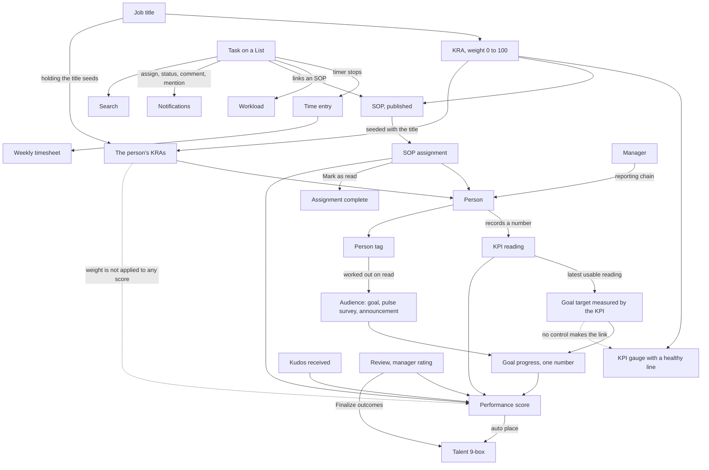

WorkwrK is two halves joined by a small number of real wires.

The **work hierarchy** is Spaces, Folders, Lists and tasks. The **alignment chain** is job title, KRA, KPI, and the person who holds them, with goals sitting on top.

This page traces only the wires that exist today. Where a connection looks obvious but is not built, it is listed at the bottom under "Links that are not wired". Read that section before you assume something rolls up.

## The map

Solid arrows are wires that exist. Dotted arrows are the connections people assume exist and that are not built.

## KPI reading to the one goal number

This is the spine of the product, and it is fully built.

1. A person opens their own record (**Teams**, **My profile**) and, on the **KRAs & KPIs** tab, records their numbers. A manager records on a report's behalf from the same tab on that person's record.
2. The reading is scored when it is saved. Direction matters: for "higher is better" the score is actual over target, for "lower is better" it is target over actual, and for "hold the line" it is how far the reading is from the line. A quantitative KPI with no healthy line gets no score, and no baseline is ever invented. A qualitative KPI scores its 1 to 5 rating against the top of the scale.
3. The latest usable reading per gauge is picked: readings sent back are ignored, readings with no value are ignored.
4. A goal target linked to that KPI reports the gauge's reading instead of its own typed number. The typed number is kept, so nothing you typed is lost.
5. Every goal's progress is worked out in one pass: a goal with targets is the mean of their progress; a parent is the mean of its own targets plus each **measured** child. Unmeasured children contribute nothing, so three empty sub-goals cannot drag a measured sibling from 60% down to 15%.

A target's own progress runs from its start value toward its target value, and the direction is read from those two numbers, so a "reduce it" target rises as the number falls.

Because every screen reads the same rollup, the same goal shows the same number everywhere: the Goals pages, the goal page, a person's record, and a review's self assessment. When a goal has nothing to measure, it says so with a dash instead of a 0% that reads as "behind".

## Job title to KRA to person

KRAs hang off a job title, not off a person.

When someone is given a job title, its KRAs are copied onto them, each at the title's weight, and every published SOP under those KRAs is assigned to them.

The mirror also runs: when you add a KRA to a job title later, everyone who already holds that title gets it. Both are safe to re-run: nothing is duplicated, and a weight someone adjusted is left alone.

Weights are checked one at a time. A single weight outside its range is refused. A total above 100 is not refused: the save goes through with a warning naming the running total, so someone already over budget can still save the edit that rebalances them. Nothing requires the total to reach 100.

## SOP to KRA to person, and back again

**Attaching.** An SOP carries a KRA, set from the **Linked KRA** picker on the SOP's page. That is what makes a procedure flow: a published SOP under a KRA is assigned to everyone who holds a job title that owns that KRA.

**Completing.** The assignee closes their own loop with **Mark as read** in the SOP header, or **Acknowledge** in **My SOPs**. That completes the assignment and stamps the date, and it works for someone with no SOP permissions at all. The completion is what the SOP read rate on the Alignment board and the SOP part of the performance score both read.

**Back the other way.** A task can link an SOP from its Related section, and the SOP's page lists those tasks under **Used by tasks**. Mentioning a task, a doc or another SOP inside a written SOP links them too.

## Person tags to audiences

A person tag comes from the one workspace tag list. Three audiences use it, and all three work out who is in them when they are read rather than storing a list of names:

| Where | What a tag does |
| --- | --- |
| Goal contributors | Everyone carrying the tag counts as a contributor |
| Pulse surveys | The survey goes to everyone carrying the tag |
| Announcements | The announcement reaches, and notifies, everyone carrying the tag |

Two consequences worth stating plainly. Tagging someone tomorrow puts them inside every goal, survey and announcement already aimed at that tag, with nothing to re-save. And an archived tag reaches nobody, everywhere.

The Directory's tag filter reads the same tags, inside what you were already allowed to see.

## The KPI approval loop

A reading moves from Not recorded to Submitted, then to Approved or Changes requested.

- The person submits from their record.
- Their manager sees the queue at **Teams**, **KPI reviews**, which reads the manager's chain, dotted lines included.
- Approving or sending back notifies the person, linking to their record, where a reading sent back can be resubmitted.

A reading sent back stops driving goal targets at once.

## What a manager's chain is

A manager's chain is everyone below them in the reporting line, all the way down. A **dotted line** is a second manager relationship, set on the org chart. Dotted-line reports appear in a manager's KPI reviews, Alignment board and team timesheets, but a dotted-line manager can read a report's record without acting on it.

## Tasks, time and timesheets

There is exactly one automatic bridge from work to hours.

When a task timer stops, the time is added to that person's **Draft** weekly timesheet, linked back to the task. If the week is already submitted or approved, nothing is written. A locked sheet is never changed.

**Log time** on the Timesheets page adds an entry by hand. Managers read their chain's sheets under **Team**, and submitted sheets waiting on them under **Approvals**.

**Workload** is separate from timesheets. It counts open tasks owned by people in a manager's chain, using each List's own statuses to tell done from open.

## The performance score

One composite score per person per month, from these parts, each skipped when there is no data:

- KPI readings from the last 90 days,
- the latest finalized review's calibrated score, or its manager rating,
- peer feedback,
- the self review,
- SOP compliance,
- goal progress for goals they own,
- task delivery on the tasks they own,
- and a small bonus for kudos received recently.

The review parts are weighted from Workspace settings, **Scoring & reviews**; the manager and self parts keep their built-in weights. The score is recalculated when a KPI reading, kudos, a goal check-in, SOP progress or a review finalization lands.

It feeds three places: a person's record, the top performers on dashboards, and **Talent (9-box)**, which can place people from their scores. Finalizing a review cycle can also place its people on the 9-box, from their review score and potential.

## Links that are not wired

These are the gaps that matter most, because each one looks like it should exist.

**KRA weight does not weight anything.** It is stored, checked, shown on a person's record and on the Alignment board, and passed to AI suggestions. No score multiplies by it. A 5% KRA and a 50% KRA currently count the same.

**A goal target cannot be linked to a KPI from any screen.** The link works and is respected on both ends, but it can only be made through the API.

**No SOP status change notifies anyone.** The draft, in review, approved and published flow is real, but nothing is sent on a change of status. Assignment does notify; the review flow does not.

**Some automation triggers do not fire yet.** **Review completed**, **SOP published** and the lead triggers are listed in the builder as not yet emitting. A **KPI reading recorded** trigger fires for readings that arrive through the API or an integration, not for numbers recorded on a person's record.

**Overdue task notifications are not sent yet.** The **Overdue** switch exists in My settings, **Notifications**; the daily notification behind it is not sent. Due today notifications are.

**Analytics does not yet count tasks.** Its people and performance charts are real; its task figures are not.

## What runs on a clock

Several of the wires above only move because a scheduled job pushes them. The ones that change what you see:

| Job | Runs | Moves |
| --- | --- | --- |
| Reminders | every few minutes | fires due reminders for people with the app closed, without ever firing one twice |
| Goal check-in reminders | weekday mornings | the stale check-in nudge and email to a goal's owner, skipping goals whose cadence is None |
| Repeating tasks | hourly | creates the next copy of an "on schedule" repeating task |
| Review cycles | each morning | creates the draft cycle for a cadence that opens automatically, and tells the People team and Admins; it never launches one |
| Scheduled announcements | every few minutes | sends a scheduled announcement's notifications once its time comes, once only |
| Tasks due today | each morning | a notification for each task due that day |
| AI teammates | every few minutes | runs the routines that are due, and expires approval requests nobody answered within 7 days |
